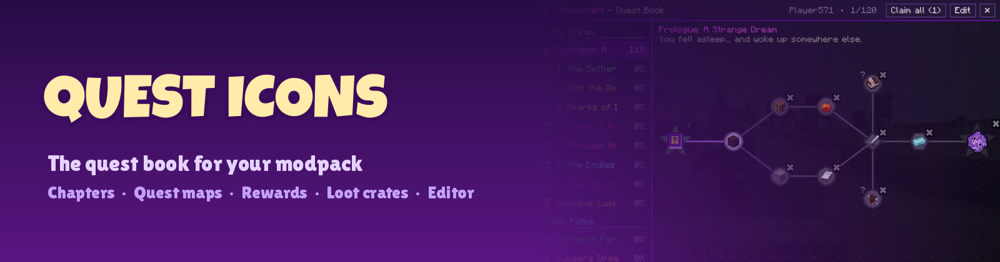
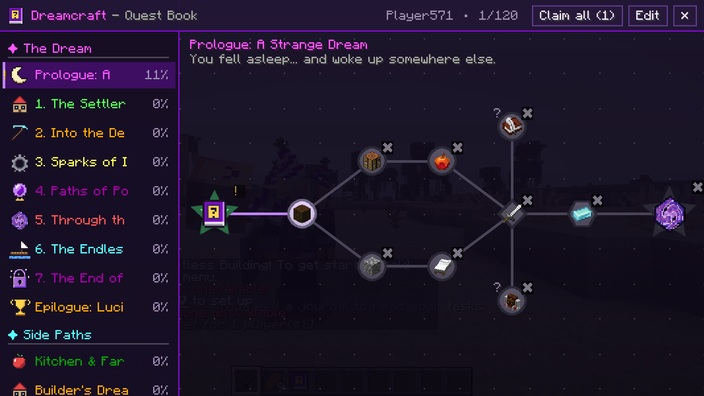
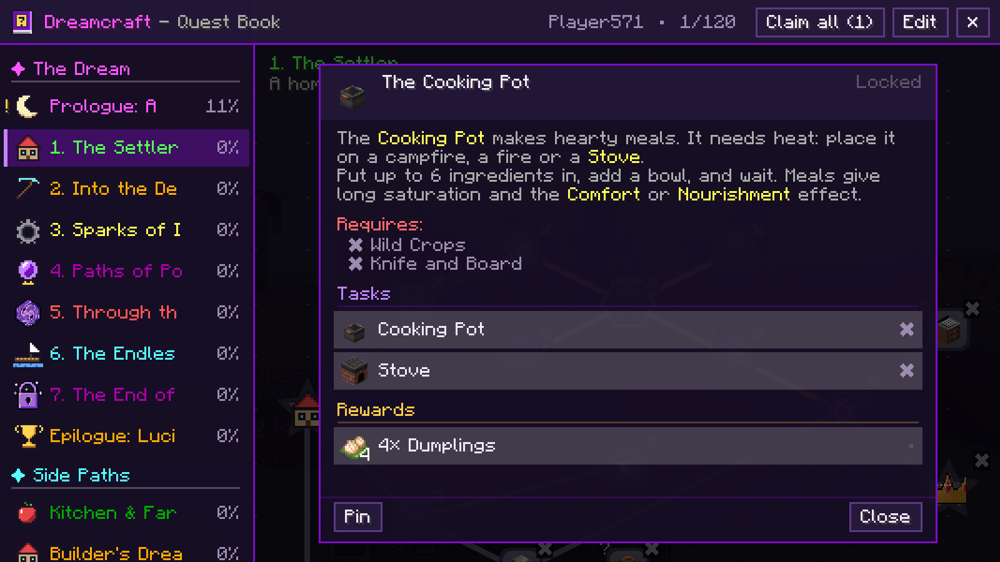
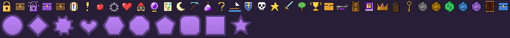

   

**Quest Icons** started as a set of icons for modpack quest books. Since 26.3 it **is** the quest book: chapters, quest maps, tasks, rewards, loot crates, teams and an in-game editor - everything a modpack needs to tell a story. It powers the quests of the **Dreamcraft** modpack.

## The quest book

- Press **J**, use the **Quest Book** item (every new player gets one) or click the book button in your inventory.
- Chapters on the left, grouped and sorted; each one shows your progress.
- Every chapter is a **map** you can drag and zoom. Quests are nodes with icons and 10 shapes (circle, square, diamond, hexagon, heart, gear, star ...), linked by dependency lines. Locked quests stay grey, finished ones turn green, and a golden **!** shows rewards that wait for you.
- Click a quest for its story, its tasks (with **Submit** buttons where needed) and its rewards (**Claim**, or **Claim all** at the top).
- **Pin** quests to see their progress on your screen while you play.

## Tasks and rewards

| Tasks | Rewards |
| --- | --- |
| Items (with tags; detected or submitted) | Items |
| Checkmark | XP and XP levels |
| Kill (entity or entity tag) | Commands |
| Advancement | Random pick from a reward table |
| Dimension, biome, structure, location | Choose one of several items |
| XP levels or points | Loot tables |
| Statistics | Advancements |
| Observation (look at a block or mob) | |

**Loot Crates** (common, rare, epic, legendary) open into a random item from the book's reward tables, so the pack decides what they hold.

## Teams

Play together: `/quests team create <name>`, `/quests team invite <player>`, `/quests team join <owner>`. Team members share task progress; rewards are claimed per player unless a reward is marked as a team reward.

## For pack makers

- Quests live in `config/questsicons/quests`, in the familiar FTB Quests layout: `data.snbt`, `chapter_groups.snbt`, `chapters/*.snbt`, `reward_tables/*.snbt`. Commas are optional, ids are 16-digit hex (or any name).
- Text supports `&` colour codes, translation keys in braces and JSON text. Descriptions can show pictures: `{image:namespace:path.png width:120 height:60}`.
- **Edit mode** (operators): drag quests, right-click for new quests, dependencies, icon/task/reward from the held item, shapes, duplicate and delete, or edit any quest or chapter as SNBT. Changes are saved and synced to everyone at once.
- Commands: `/quests open | reload | complete <quest|all> [players] | reset <quest|all> [players] | givebook <players>`.

## The icons

32 item icons for quests and chapters: portals, locks, crowns, keys, swords, shields, gears, potions, maps, trophies, a raft and more - plus the crates and the quest book.

---

Made for **[Dreamcraft](https://www.curseforge.com/minecraft/modpacks/dreamcraft-new)**. Want a server? [BisectHosting](https://bisecthosting.com/kasax007) - code **KASAX007** for 25% off.
